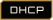
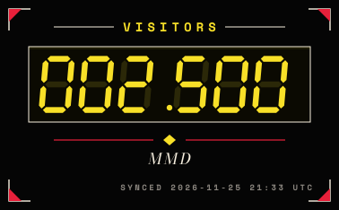

 

<!-- Live rank badge, if you prefer it to the themed one above:

-->

<h2 align="center"></h2>

I work in cybersecurity. I build guides, scripts and tools that make threats easier to understand and harder to ignore.

Away from the keyboard I am drawn to surrealism, classical art, romanticism, dark academia and mythology: stone, shadow, and old stories about gates and the people who guard them.

- **Cybersecurity education.** Threat guides, detection scripts and a classroom chatbot.
- **Security fundamentals.** Windows administration, auditing and incident response.
- **Tooling.** Python first, with web and systems work around it.

<h2 align="center" id="tech-stack--skills"></h2>

<h3>Programming Languages</h3>

<h3>Web &amp; Frameworks</h3>

<h3>Databases</h3>

<h3>Cybersecurity</h3>

<h3>Security Tools</h3>

<h3>Networking</h3>

<h3>Systems</h3>

<h3>Dev Tools &amp; Workflow</h3>

<h2 align="center" id="github-stats"></h2>

<h3>Activity Graph</h3>

<h2 align="center" id="top-languages"></h2>

<h2 align="center" id="profile-view"></h2>

  

<h3>Pacman Contribution Animation</h3>

<h2 align="center" id="lets-connect"></h2>

<b>Ready to build and defend the future together? Let's connect and create something amazing.</b>

 

