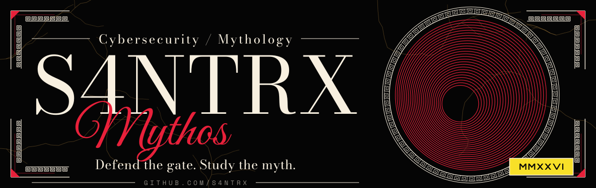
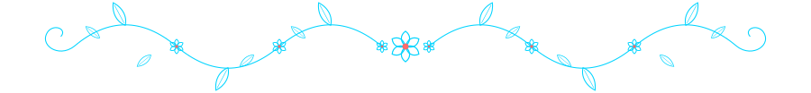

 

  

<h2 align="center">About</h2>

<i>A bastion host is the hardened gate between two networks. I keep the name as a reminder to guard the threshold.</i>

I work in cybersecurity and build educational tools for it. Outside the terminal I am drawn to surrealism, classical art, romanticism, dark academia and mythology, and I bring that eye to my work: careful structure, a feeling for atmosphere, and a habit of looking for what is hidden in the corners.

- **Cybersecurity education.** Guides, detection scripts and a classroom chatbot that explain threats and how to defend against them.
- **Security fundamentals.** Windows administration, auditing and incident response.
- **Tooling.** Python first, with web and systems work around it.

<h3>Index</h3>

| Section | What it holds |
| :-: | :-: |
| [Featured work](#featured-work) | Selected repositories and a reading order |
| [Tech Stack & Skills](#tech-stack--skills) | Languages and tools |
| [GitHub Stats](#github-stats) | Activity, languages and streaks |
| [Profile View](#profile-view) | The visitor counter |
| [Let's Connect](#lets-connect) | Where to find me |

<h2 align="center" id="featured-work">Featured work</h2>

<i>The pinned repositories, in plain words.</i>

| Project | Kind | Description |
| :-: | :-: | :-: |
| [Cybersecurity-Threats-Guide](https://github.com/s4ntrx/Cybersecurity-Threats-Guide) | Guide, Python | Documentation, detection scripts and prevention strategies for cybersecurity threats and vulnerabilities |
| [S4ntrx-Bot](https://github.com/s4ntrx/S4ntrx-Bot) | Chatbot, Python | A multi-user cybersecurity education chatbot built with Flask for a classroom project |
| [My-Windows-Cheat-sheet](https://github.com/s4ntrx/My-Windows-Cheat-sheet) | Reference | Windows commands for administration, auditing and incident response, compiled for a class assignment |
| [MUST-Campus](https://github.com/s4ntrx/MUST-Campus) | Web, HTML | A campus web project |
| [Dark-Web](https://github.com/s4ntrx/Dark-Web) | Tools | Tools for exploring the dark web |
| [mitmproxy](https://github.com/s4ntrx/mitmproxy) | Fork, Python | An interactive, TLS-capable intercepting HTTP proxy for penetration testers and developers |

<h3 align="center">Where to begin</h3>

1. Open [Cybersecurity-Threats-Guide](https://github.com/s4ntrx/Cybersecurity-Threats-Guide) for the main body of educational material.
2. Try [S4ntrx-Bot](https://github.com/s4ntrx/S4ntrx-Bot) to see the guide turned into an interactive tool.
3. Read [My-Windows-Cheat-sheet](https://github.com/s4ntrx/My-Windows-Cheat-sheet) for the systems and incident-response side.

<h2 align="center" id="tech-stack--skills">Tech Stack &amp; Skills</h2>

<i>What the work is made with.</i>

<h3>Programming Languages</h3>

<h3>Tools &amp; Technologies</h3>

<h2 align="center" id="github-stats">GitHub Stats</h2>

<i>The ledger, kept by machines.</i>

 

<h3>Activity Graph</h3>

<h2 align="center" id="profile-view">Profile View</h2>

<i>Every visit moves the display forward.</i>

  

<h3>Pacman Contribution Animation</h3>

<h2 align="center" id="lets-connect">Let's Connect</h2>

<b>Ready to build and defend the future together? Let's connect and create something amazing.</b>

 

